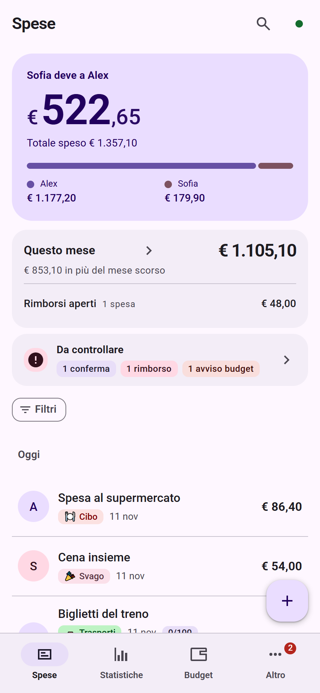
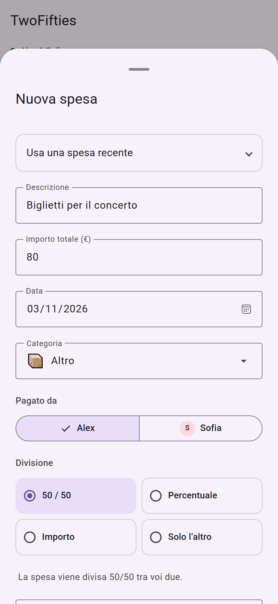
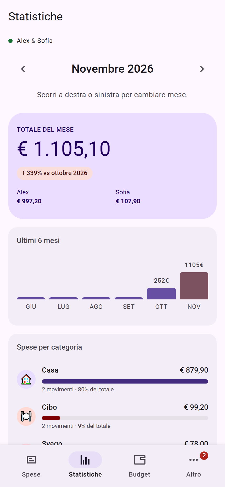
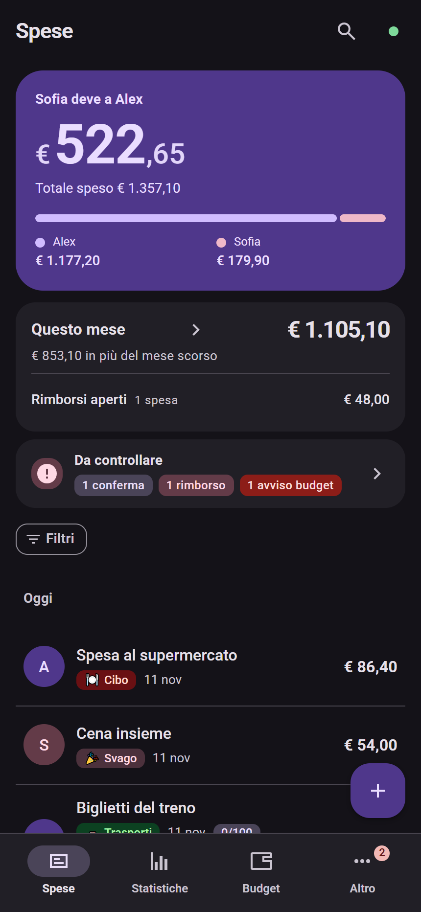
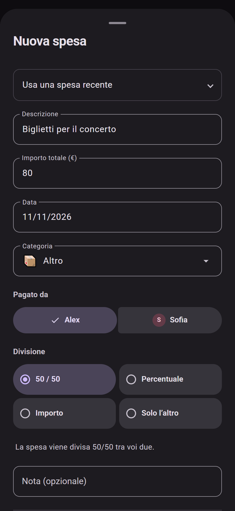
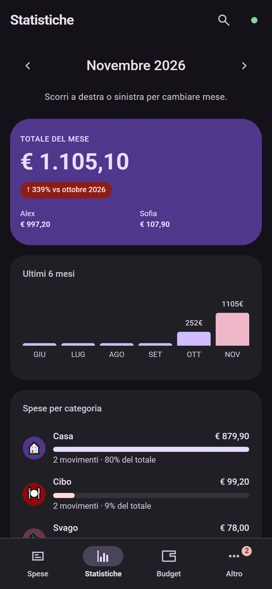

<div align="center">

# TwoFifties

### Dividete le spese. Tenete chiaro il saldo.

L'app per gestire le spese di due persone: un'interfaccia Material 3, divisioni flessibili e una visione condivisa delle uscite quotidiane. Da ospitare sul proprio server.

**Sviluppato da JOSHBALZANI** · [English](README.md) · [Galleria screenshot](docs/screenshots/it/README.md)

[](https://github.com/JoshualBalzani/TwoFifties/actions/workflows/ci.yml) [](LICENSE) [](https://nodejs.org/)

</div>

**Sito di presentazione:** [anteprima, pubblicazione Pages e dominio personalizzato](website/README.it.md).

<table>
<tr><th colspan="3">Tema chiaro</th></tr>
<tr><td align="center"></td><td align="center"></td><td align="center"></td></tr>
<tr><th colspan="3">Tema scuro</th></tr>
<tr><td align="center"></td><td align="center"></td><td align="center"></td></tr>
</table>

## Le spese di tutti i giorni, insieme

La spesa al supermercato, l'affitto, una cena o un biglietto anticipato per l'altra persona: TwoFifties tiene traccia di chi ha pagato, di quanto spetta a ciascuno e di cosa rimane da saldare. È pensata per coppie, coinquilini e due persone che condividono delle spese.

Il nome non obbliga a dividere tutto a metà. Ogni movimento può seguire una divisione diversa, con promemoria per i rimborsi e una conferma prima di registrare il saldo.

## Un flusso completo, dalla spesa al saldo

TwoFifties riunisce registrazione delle spese, ripartizione, controllo del budget e riconciliazione in uno spazio condiviso. Ogni movimento conserva chi ha effettivamente pagato; la cronologia aiuta a ricostruire le modifiche e il backup permette di conservare e ripristinare lo spazio di lavoro. L’obiettivo è ridurre i conteggi manuali mantenendo comprensibili i contributi individuali.

1. **Configura lo spazio:** inserisci i due nomi e scegli lingua e tema.
2. **Registra una spesa:** indica chi ha pagato e come assegnare il costo.
3. **Controlla la situazione:** consulta saldo, statistiche, budget e rimborsi in attesa.
4. **Registra il pagamento:** conferma il saldo quando il trasferimento è avvenuto.

Per esempio, se Alex paga €80 per un acquisto interamente a carico di Sofia, la modalità dedicata attribuisce €0 ad Alex e €80 a Sofia, conservando Alex come pagatore. Questo movimento genera un debito di €80 verso Alex; il saldo complessivo tiene conto anche delle altre spese.

## Tutto quello che puoi gestire

| Funzione | Cosa permette di fare |
| --- | --- |
| **Spese e saldo** | Registra pagatore, data, categoria, descrizione e nota. Consulta contributi personali e saldo residuo. |
| **Divisioni flessibili** | Scegli 50/50, percentuali, importi esatti o tutto a carico dell'altra persona, conservando chi ha realmente pagato. |
| **Saldo con conferma** | Dal pulsante + scegli nuova spesa o saldo. Una finestra di conferma protegge la registrazione del pagamento. |
| **Ricerca e filtri** | Cerca nelle descrizioni e nelle note, filtra i movimenti e salva le viste da richiamare. |
| **Statistiche e budget** | Esplora totali mensili e categorie, confronta periodi e imposta limiti mensili per categoria. |
| **Spese ricorrenti** | Gestisci i pagamenti periodici e controlla le proposte prima di registrare le ricorrenze che richiedono conferma. |
| **Anticipi e rimborsi** | Tieni visibili le somme anticipate, aggiungi scadenze, esporta promemoria nel calendario e registra i rimborsi. |
| **Ricevute** | Allega immagini da un file o dalla fotocamera. Le immagini vengono ridimensionate prima del caricamento. |
| **Storico e cestino** | Consulta autore e modifiche, confronta i valori precedenti e recupera le spese eliminate dal cestino entro 30 giorni. |
| **Backup e file** | Crea e ripristina backup, importa JSON/CSV ed esporta i movimenti in Excel. |
| **Preferenze** | Modifica i nomi, scegli tema chiaro/scuro/sistema e imposta italiano o inglese sul singolo dispositivo. |

## Un'interfaccia pensata per il telefono

La navigazione inferiore mette a portata di mano Spese, Statistiche, Budget e Altro. Gli strumenti sono raccolti per funzione; le impostazioni distinguono persone, aspetto, preferenze per le nuove spese e dati. Superfici, tipografia e ruoli colore Material 3 mantengono una struttura coerente nei temi chiaro e scuro. Le gesture supportano la chiusura dei pannelli e le interazioni di navigazione previste.

Al primo avvio una presentazione guidata introduce l'app. Puoi saltare la spiegazione e le preferenze facoltative: **i due nomi rimangono obbligatori e devono essere diversi**. Una nuova installazione parte vuota, senza spese o dati personali precompilati.

## Guarda tutte le funzioni

[**Apri le 28 schermate nei temi chiaro e scuro →**](docs/screenshots/it/README.md)

Le immagini mostrano schermate reali dell'app: configurazione, spese, azioni rapide, saldo, ricerca, statistiche, budget, rimborsi, ricorrenze, categorie, viste salvate, storico, cestino, backup, importazione, esportazione e impostazioni. Questo manuale usa soltanto screenshot in italiano: 28 schermate in entrambi i temi, per un totale di 56 immagini.

**Nomi e movimenti nelle immagini sono inventati.** Gli screenshot sono generati su un server temporaneo isolato; l'app distribuita continua a partire senza dati.

## Scegliere l’installazione

| Ambiente | Percorso |
| --- | --- |
| Computer o server con Docker | Compilazione dal Dockerfile incluso e avvio con Compose. |
| Server con Node.js 24+ | Avvio diretto del server Express, senza database esterno. |
| TrueNAS con Docker Apps 24.10+ | App personalizzata tramite YAML e dataset dedicato ai backup. |

## Installazione su TrueNAS

Usa la [guida TrueNAS in italiano](docs/TRUENAS.it.md) e il [modello da adattare](deploy/truenas.yaml). Prepara le cartelle source e backups in un dataset, copia i sorgenti sul NAS, assegna alla cartella dati accesso per UID/GID 1000 e apri **Apps → Discover Apps → Install via YAML**. Incolla il modello sostituendo percorsi, credenziali ed eventuale porta, poi attendi compilazione e avvio. L’app si apre su **http://IP_DEL_NAS:5001**.

Il modello compila direttamente i sorgenti, senza presupporre un’immagine pubblica. La guida comprende migrazione dei dati, ricevute, aggiornamenti e verifica della persistenza; il riferimento ufficiale è la [documentazione TrueNAS sulle app personalizzate](https://apps.truenas.com/managing-apps/installing-custom-apps/).

## Avvio con Docker

Installa Docker Desktop oppure Docker Engine con Compose, quindi:

```sh
git clone https://github.com/JoshualBalzani/TwoFifties.git
cd TwoFifties
cp .env.example .env
docker compose up --build -d
```

In PowerShell puoi usare `Copy-Item .env.example .env`. Apri **http://localhost:5001** e completa la configurazione iniziale. La cartella visibile `backups/`, accanto a `docker-compose.yml`, conserva i dati anche quando ricostruisci il container. Dentro Docker è collegata a `/app/data`.

Prima dell'accesso da internet imposta **entrambe** le credenziali `AUTH_USER` e `AUTH_PASS` nel file `.env` e usa un reverse proxy HTTPS. Senza credenziali l'accesso è libero, adatto all'uso locale. Non pubblicare il file `.env`.

## Avvio con Node.js

Richiede **Node.js 24 o successivo**.

```sh
npm ci
npm ci --prefix server
npm start
```

Apri **http://localhost:5001**. Stato, ricevute e backup vengono conservati nella cartella `backups/`, esclusa da Git. Le variabili facoltative sono in [.env.example](.env.example). Prima degli aggiornamenti salva una copia della cartella `backups/`.

## Offline e sincronizzazione

Dopo una visita online che abbia memorizzato l'app, puoi riaprirla offline e salvare modifiche nel browser. Al ritorno della connessione il server riceve gli aggiornamenti; eventuali conflitti vengono proposti per la risoluzione. I dispositivi collegati allo stesso server condividono uno spazio di lavoro. Nomi e tema sono condivisi; la lingua è una preferenza del dispositivo.

## Struttura e limiti operativi

| Componente | Scelta del progetto |
| --- | --- |
| Interfaccia | HTML, CSS e JavaScript; font Roboto inclusi e ruoli Material 3 per i due temi. |
| Server | Node.js 24+ ed Express 5; serve sia l’app sia le API. |
| Archivio | File JSON e immagini nella cartella backups, senza database da amministrare. |
| Dispositivi | Uno spazio condiviso per server, con copia locale e risoluzione dei conflitti. |
| Lingue | Italiano e inglese, con scelta per dispositivo in Impostazioni → Lingua. |
| Ambito | Due persone, importi in euro e autenticazione condivisa dello spazio. |

Non sono previsti conti bancari collegati, trasferimenti automatici di denaro, contabilità fiscale o account con ruoli separati. La conferma di un saldo registra un pagamento già effettuato altrove.

## Dati, privacy e pubblicazione

Scegli tu dove ospitare il server. Il browser mantiene una copia locale; il server conserva stato condiviso, ricevute, storico e backup. L'accesso usa un'autenticazione Basic comune allo spazio di lavoro, senza account personali separati. L'app non cifra i file e i dati del browser a riposo: usa dispositivi affidabili, HTTPS e backup protetti. Consulta [SECURITY.md](SECURITY.md).

**Questo repository pubblica il codice sorgente.** Per usare l'app online serve un host Node.js o Docker: GitHub Pages da solo non esegue l'API. Non è incluso un servizio cloud gestito.

## Verifiche e sviluppo

```sh
npm test
npx playwright install chromium
npm run test:browser
```

I test verificano divisioni, saldi, modifiche concorrenti, conflitti, ricevute, backup, primo avvio, lingue, navigazione mobile e salvataggio offline. GitHub Actions esegue la suite automatica. Il server usa Express 5; l'interfaccia usa HTML, CSS, JavaScript e font Roboto inclusi localmente.

Per rigenerare la galleria: `node scripts/screenshots.cjs`. Lo script crea soltanto dati dimostrativi temporanei e lascia vuota la cartella dati dell'app. Su Windows utilizza Microsoft Edge installato; sulle altre piattaforme Chromium di Playwright.

[Contribuire](CONTRIBUTING.md) · [Novità](CHANGELOG.md) · [Licenze di terze parti](THIRD_PARTY_NOTICES.md)

## Licenza

[MIT](LICENSE) · Copyright © 2026 **JOSHBALZANI**. Font e Material Color Utilities mantengono le proprie licenze.

## Dove sono i backup e come importarli

Nella cartella **backups** del server trovi `latest.json` (stato attuale), `daily-*.json` (copie giornaliere), `manual-*.json` (copie manuali), `pre-restore-*.json` (copie di sicurezza) e `receipts/` (immagini delle ricevute). Git esclude i dati reali: viene pubblicato solo il segnaposto della cartella vuota.

1. Apri **Altro → Backup e ripristino**.
2. **Crea backup** salva un file nella cartella del server. L’icona **Scarica** lo porta sul dispositivo.
3. Per recuperare una copia scaricata, premi **Importa backup** e seleziona il JSON (massimo 4,5 MB).
4. Conferma il ripristino: sostituisce spese, ricorrenze, categorie, nomi, preferenze e budget. Prima di procedere il server valida il file e salva lo stato precedente in un backup di sicurezza. Annullando, i dati restano invariati.

**Importa movimenti** serve invece ad aggiungere movimenti da un file, non a ripristinare l’intero spazio. Il JSON contiene i riferimenti alle ricevute: se cambi server copia anche `backups/receipts/`, oppure conserva tutta la cartella backups.

### Migrazione dal vecchio volume Docker

Prima di avviare la nuova configurazione:

```sh
docker compose stop twofifties
docker compose cp twofifties:/app/data/. ./backups
docker compose up --build -d
```

Non eliminare il vecchio volume `twofifties_twofifties-data` finché non hai controllato la copia. Su Linux la cartella deve essere scrivibile dall’utente del container, UID 1000: se necessario usa `sudo chown -R 1000:1000 backups`. Per Node, i dati del precedente percorso `data/` vengono copiati in `backups/` al primo avvio, se manca lo stato attuale nella nuova cartella; la cartella originale viene conservata.

I backup della precedente app SPESE vengono convertiti automaticamente quando i nomi salvati identificano le due persone senza ambiguità. Pagatori, quote e saldi sono associati al nuovo formato, senza cambiare descrizioni o note. Il JSON originale importato viene conservato insieme alla copia di sicurezza precedente al ripristino. Se l’associazione non è certa, i dati attuali non vengono sostituiti.
