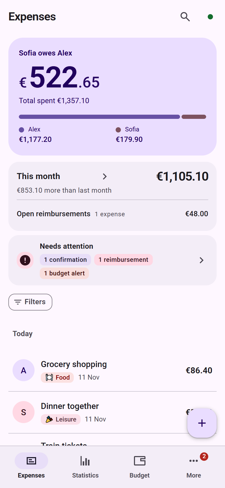
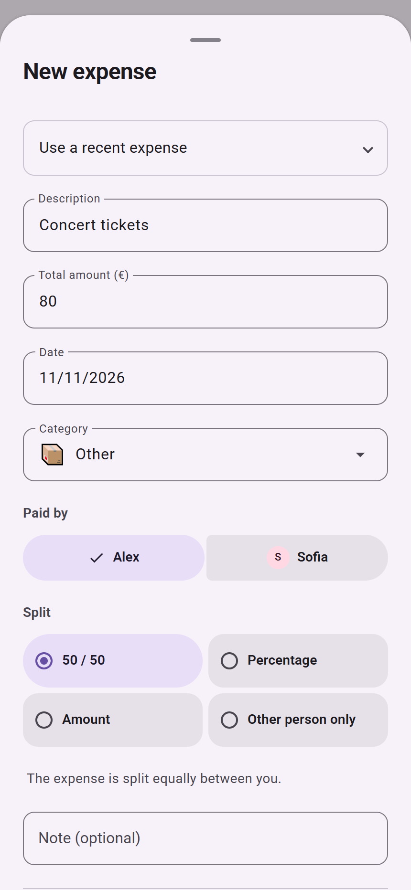
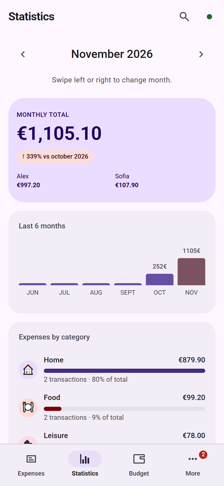
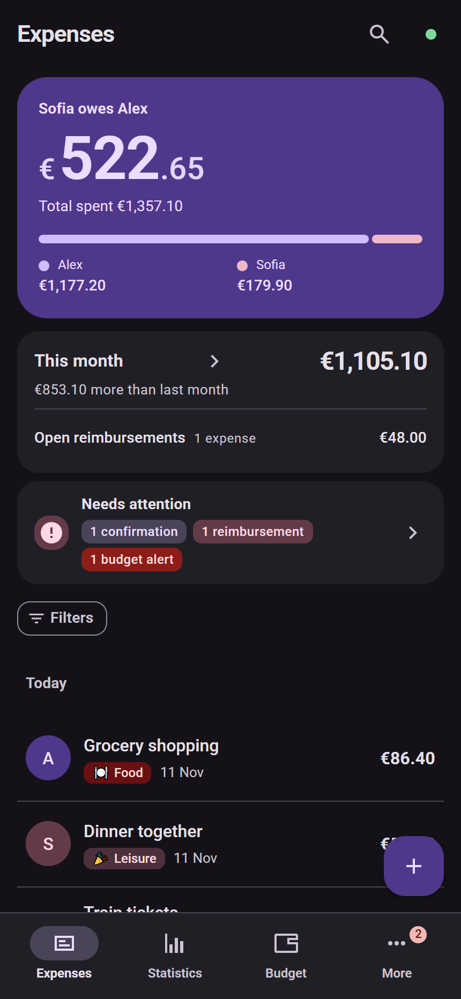
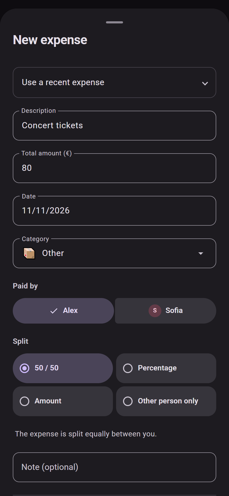
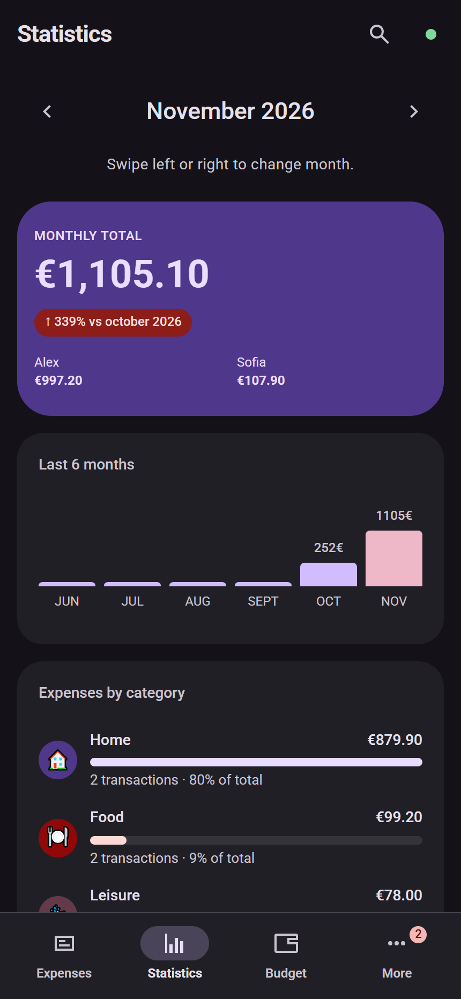
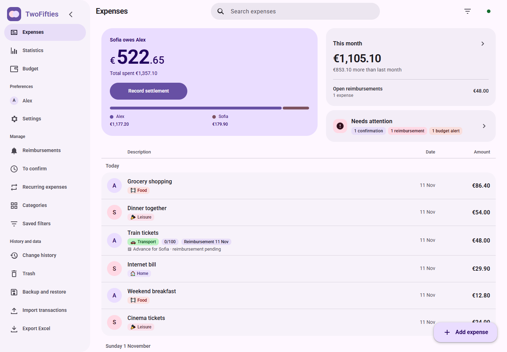
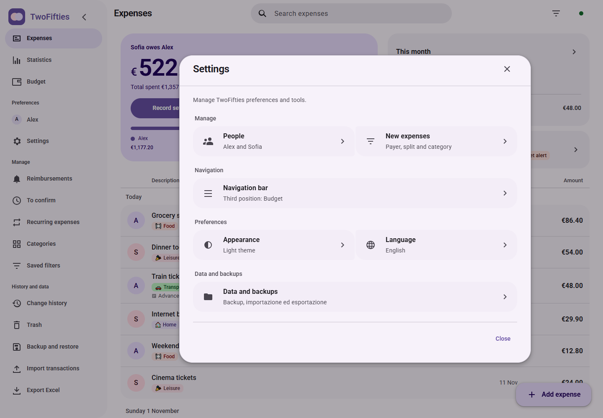
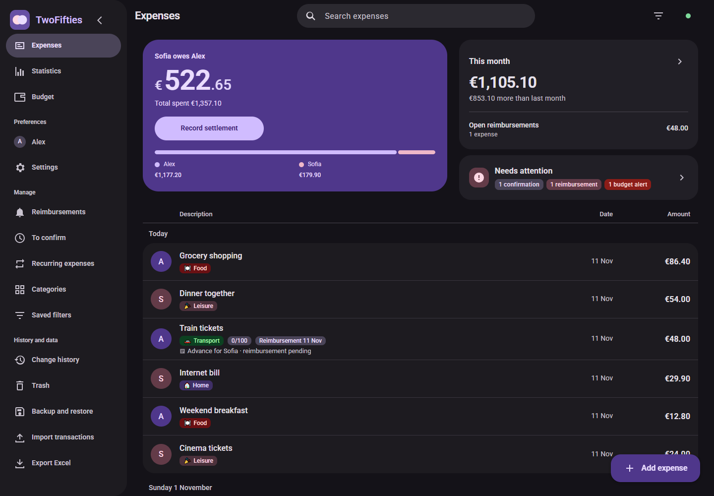
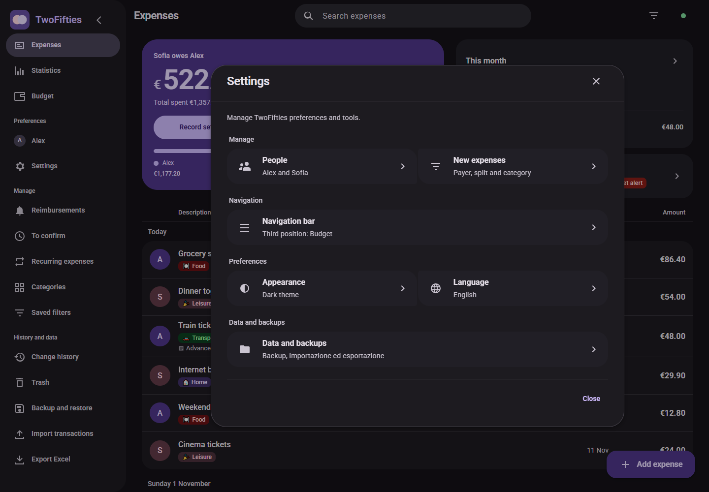

<div align="center">

# TwoFifties — Self-hosted expense sharing for couples and roommates

### Open-source expense tracker and bill splitting for two people.

TwoFifties is a free, self-hosted shared expense tracker for couples, roommates and friends. Split bills flexibly, track reimbursements and budgets, and see who owes what. Run it with Docker or Node.js on your own server.

**Developed by JOSHBALZANI** · [Italiano](README.it.md) · [Screenshot gallery](docs/screenshots/en/README.md)

[](https://github.com/JoshualBalzani/TwoFifties/actions/workflows/ci.yml) [](LICENSE) [](https://nodejs.org/)

</div>

**Product website:** [preview, GitHub Pages and custom-domain setup](website/README.md).

<table>
<tr><th colspan="3">Light mode</th></tr>
<tr><td align="center"></td><td align="center"></td><td align="center"></td></tr>
<tr><th colspan="3">Dark mode</th></tr>
<tr><td align="center"></td><td align="center"></td><td align="center"></td></tr>
</table>

### Desktop app · Light and dark Material 3 Expressive

<table>
<tr><th>Expenses and desktop navigation · light</th><th>Settings and desktop navigation · light</th></tr>
<tr><td></td><td></td></tr>
<tr><th>Expenses and desktop navigation · dark</th><th>Settings and desktop navigation · dark</th></tr>
<tr><td></td><td></td></tr>
</table>

**Quick start:** install with Docker Compose or Node.js 24+. This repository contains the application source; the [GitHub Pages website](https://joshualbalzani.github.io/TwoFifties/) is a product guide and does not host the app API. Installation guides for Docker, Node.js and TrueNAS are below.

## Built for everyday life, together

Groceries, rent, a weekend away or a ticket bought for the other person: TwoFifties keeps track of who paid, who owes what and what remains to be settled. It works well for couples, roommates and any two people sharing a budget.

The name does not mean every expense must be split in half. Choose the split that fits the situation, keep reimbursement deadlines visible and confirm a settlement when payment has actually happened.

## One workflow, from recording to reconciliation

TwoFifties brings expense entry, allocation, budget review and settlement into one shared workspace. Each transaction retains the person who actually paid; history makes changes traceable, and backups let you preserve and restore the workspace. The aim is to reduce manual calculations while keeping individual contributions understandable.

1. **Set up your workspace:** enter both names and choose language and theme.
2. **Record an expense:** identify the payer and assign the cost.
3. **Review your position:** check the balance, statistics, budgets and outstanding reimbursements.
4. **Record payment:** confirm a settlement after the money has changed hands.

For example, if Alex pays €80 for an item entirely owed by Sofia, the dedicated split assigns €0 to Alex and €80 to Sofia while retaining Alex as the payer. That transaction creates an €80 amount owed to Alex; the overall balance also includes other transactions.

## What you can do

| Area | Features |
| --- | --- |
| **Expenses & balance** | Record the payer, date, category, description and note. See each person's contributions and the remaining balance. |
| **Flexible splits** | Split 50/50, choose percentages, enter exact shares or assign the full cost to the other person while recording who paid. |
| **Safe settlements** | Open the + button for expense and settlement actions. A confirmation dialog guards settlement registration. |
| **Find what matters** | Search descriptions and notes, filter transactions and save reusable views. |
| **Statistics & budgets** | Explore monthly totals and category breakdowns, compare periods and set monthly category limits. |
| **Recurring expenses** | Manage recurring payments and review proposed amounts before recording expenses that require confirmation. |
| **Reimbursements** | Track advances, set due dates, export calendar reminders and record reimbursements. |
| **Receipts** | Attach receipt images from a file or the device camera. Images are resized before upload. |
| **History & recovery** | Review changes and their author, compare previous values and restore deleted expenses from the 30-day trash. |
| **Your data** | Create and restore backups, import JSON/CSV and export transactions to Excel. |
| **Your preferences** | Edit both names, select light/dark/system theme and switch between Italian and English on each device. |

## Material 3 Expressive on mobile and desktop

On mobile, bottom navigation keeps Expenses, Statistics, Budget and More within reach. On desktop, an expandable side navigation exposes every destination directly and can collapse to an icon rail. Desktop dialogs and forms use the wider screen; short windows keep the navigation scrollable. Material 3 Expressive surfaces, emphasized typography, connected button groups and spring motion remain consistent in both themes. Details show the same information on phones and desktop, and reduced motion is respected.

The first-run guide introduces the app and asks for the two names. You can skip the introduction and optional preferences; both names remain required and must be different. A new installation contains no personal records or sample transactions.

## See the app in action

[**Browse 28 screens in light and dark mode →**](docs/screenshots/en/README.md)

The gallery covers onboarding, expenses, quick actions, settlements, search, statistics, budgets, reimbursements, recurring expenses, categories, saved views, history, trash, backup, import/export, settings and both themes. Screenshots use **fictitious names and transactions** in an isolated temporary server. The installable app still starts empty. This English manual links exclusively to English screenshots: 28 screens in both themes, 56 images in total.

## Choose an installation

| Environment | Installation path |
| --- | --- |
| Computer or server with Docker | Build the included Dockerfile and start with Compose. |
| Server with Node.js 24+ | Run Express directly, without an external database. |
| TrueNAS Docker Apps 24.10+ | Deploy a custom YAML app with dedicated persistent storage. |

## Install on TrueNAS

Follow the [English TrueNAS guide](docs/TRUENAS.md) and use the [configuration template](deploy/truenas.yaml). Prepare source and backups directories in a dataset, copy the source onto the NAS, grant UID/GID 1000 write access to persistent storage, then open **Apps → Discover Apps → Install via YAML**. Paste the template, replace its paths and credentials, adjust the host port if needed and wait for the build. Open **http://YOUR_NAS_IP:5001**.

The template builds from source rather than assuming a published container image exists. The guide covers migration, receipt files, updates and persistence checks; see the [official TrueNAS custom app documentation](https://apps.truenas.com/managing-apps/installing-custom-apps/) for the platform workflow.

## Start with Docker

Requirements: Docker Engine with Docker Compose, or Docker Desktop.

```sh
git clone https://github.com/JoshualBalzani/TwoFifties.git
cd TwoFifties
cp .env.example .env
docker compose up --build -d
```

On Windows PowerShell, use `Copy-Item .env.example .env` instead of `cp` if preferred. Open **http://localhost:5001** and complete the first-run setup. The visible `backups/` directory beside `docker-compose.yml` preserves server data across container rebuilds. It is bind-mounted to `/app/data` in the container.

Set **both** `AUTH_USER` and `AUTH_PASS` in `.env`, and use an HTTPS reverse proxy before exposing the app to the internet. Blank credentials allow unauthenticated access and are intended for local use. Do not commit `.env`.

## Run with Node.js

Requires **Node.js 24 or newer**.

```sh
npm ci
npm ci --prefix server
npm start
```

Open **http://localhost:5001**. Local server state, receipts and backups are written to `backups/`, which Git ignores. Optional environment variables are documented in [.env.example](.env.example). Back up the entire `backups/` directory before upgrades.

## Offline use and synchronization

After an online visit has cached the app shell, the browser can reopen it offline and save changes locally. When the configured server is reachable again, changes synchronize; conflicting edits are presented for resolution. Devices connected to the same server use the same shared workspace. Names and theme belong to that workspace; language is a per-device preference.

## Architecture and operational scope

| Component | Project choice |
| --- | --- |
| Interface | HTML, CSS and JavaScript, local Roboto fonts and Material 3 Expressive roles in both themes. |
| Server | Node.js 24+ and Express 5 serve the application and API. |
| Storage | JSON state and receipt images in the backups folder, with no separate database service. |
| Devices | One shared workspace per server, local browser copies and conflict resolution. |
| Languages | Italian and English, selected per device under Settings → Language. |
| Scope | Two people, euro amounts and workspace-wide authentication. |

The app does not connect bank accounts, transfer money, provide tax accounting or assign separate user roles. A settlement records a payment made through another channel.

## Privacy and deployment

You choose where to run the server. The browser keeps a local copy; the server stores shared state, receipts, history and backups. There is one workspace with shared Basic authentication, not separate user accounts. The app does not encrypt browser storage or server files at rest. Use trusted devices, HTTPS and protected backups. See [SECURITY.md](SECURITY.md).

**GitHub hosts this source repository.** Running TwoFifties online requires a Node.js or Docker host; GitHub Pages alone cannot run the API. This repository does not provide a managed cloud service.

## Development and verification

```sh
npm test
npx playwright install chromium
npm run test:browser
```

Tests cover split arithmetic, balances, concurrent edits, conflicts, receipts, backup/restore, onboarding, language switching, mobile navigation and offline saving. GitHub Actions repeats the automated suite. Express 5 serves the API and static app; the interface uses HTML, CSS and JavaScript with locally bundled Roboto fonts.

To reproduce the documentation images, run `npm run screenshots` after installing the browser. The script uses temporary fictitious data and leaves the application data directory empty. On Windows the browser scripts use installed Microsoft Edge; other platforms use Playwright Chromium.

[Contributing](CONTRIBUTING.md) · [Changelog](CHANGELOG.md) · [Third-party notices](THIRD_PARTY_NOTICES.md)

## License

[MIT](LICENSE) · Copyright © 2026 **JOSHBALZANI**. Fonts and Material Color Utilities retain their respective licenses.

## Backup files and restore

The server creates `backups/latest.json` (current state), `daily-*.json` (daily copies), `manual-*.json` (manual backups), `pre-restore-*.json` (safety copies) and `backups/receipts/` (receipt images). Runtime files are excluded from Git; only the empty directory placeholder is published.

In **More → Backup and restore**, use **Create backup** to save on the server, the download icon to keep a JSON copy on your device, or **Import backup** to choose a previously downloaded JSON file (up to 4.5 MB). Confirm to replace expenses, recurring expenses, categories, names, preferences and budgets. The server validates the file and saves the previous state before restoring. Cancel leaves the workspace unchanged. **Import transactions** is a separate action for adding transactions, not a full restore.

A JSON backup references receipt images; when moving servers, copy `backups/receipts/` too, or copy the entire backups folder.

### Upgrade from the previous Docker volume

Before starting the new configuration, preserve the existing container data:

```sh
docker compose stop twofifties
docker compose cp twofifties:/app/data/. ./backups
docker compose up --build -d
```

Keep the old `twofifties_twofifties-data` volume until you have verified the migrated files. On Linux, the bind directory must be writable by container UID 1000; if needed, set its owner with `sudo chown -R 1000:1000 backups`. Node installations using the old `data/` default are copied to `backups/` on first start when no current state exists there; the original directory is retained.

Backups from the previous SPESE app are converted automatically when their saved names identify the two people unambiguously. Payers, shares and settlements are mapped to the current format without translating descriptions or notes. The original uploaded JSON is retained alongside the pre-restore safety copy. Ambiguous identities are rejected without replacing the workspace.
