# TwoFifties · Mobile screenshot gallery

[English overview](../../README.md) · [Presentazione italiana](../../README.it.md)

26 real mobile captures at 430 × 932 CSS pixels (2× resolution). All names and transactions are fictitious, generated on an isolated temporary server. The released app starts empty. / Nomi e movimenti sono inventati; la versione distribuita parte vuota.

<table>
<tr>
<td width="50%" valign="top"><h3>01 · Presentazione guidata</h3>
Guided introduction
<a href="01-benvenuto.png">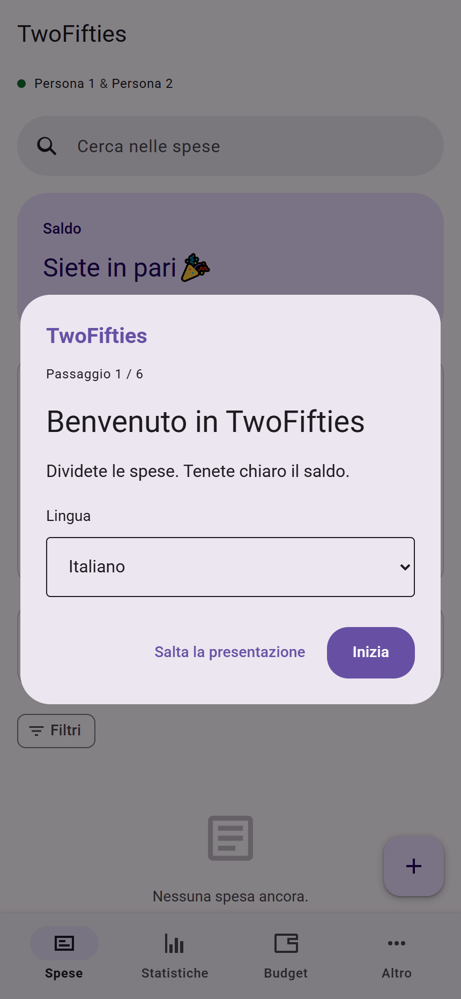</a></td>
<td width="50%" valign="top"><h3>02 · Due nomi, uno spazio condiviso</h3>
Two names, one shared workspace
<a href="02-nomi.png">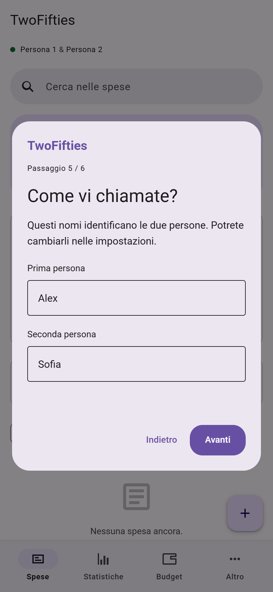</a></td>
</tr>
</table>

<table>
<tr>
<td width="50%" valign="top"><h3>03 · Spese e saldo condiviso</h3>
Shared expenses and balance
<a href="03-spese.png">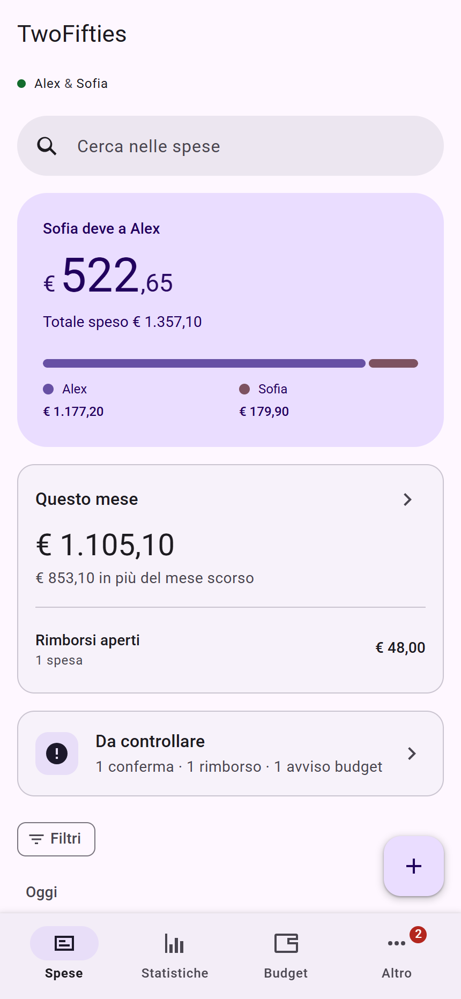</a></td>
<td width="50%" valign="top"><h3>04 · Azioni rapide dal pulsante +</h3>
Quick actions from the + button
<a href="04-azioni.png">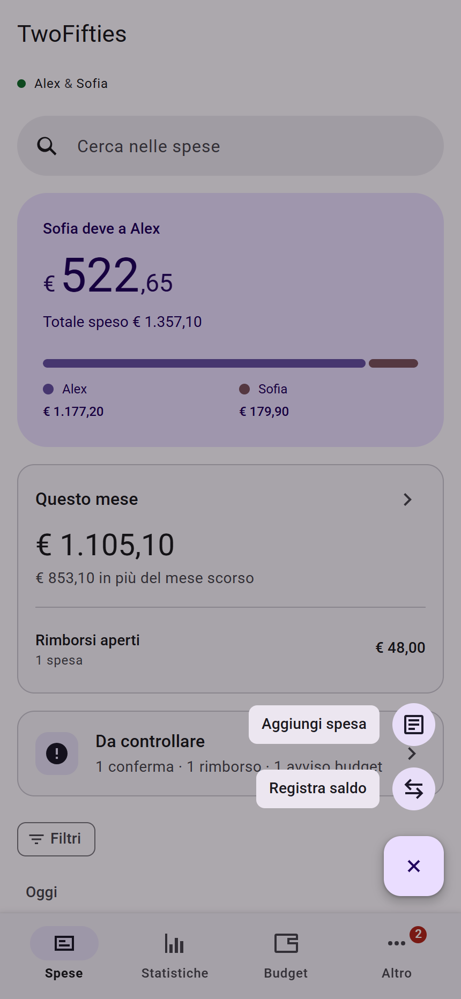</a></td>
</tr>
</table>

<table>
<tr>
<td width="50%" valign="top"><h3>05 · Nuova spesa e divisione</h3>
New expense and split options
<a href="05-nuova-spesa.png">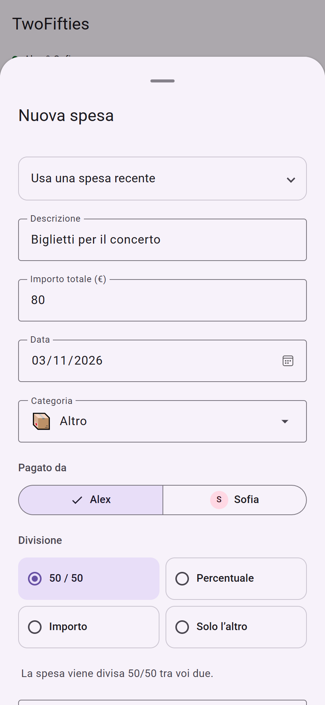</a></td>
<td width="50%" valign="top"><h3>06 · Note, scadenze e ricevute</h3>
Notes, due dates and receipts
<a href="06-note-ricevute.png">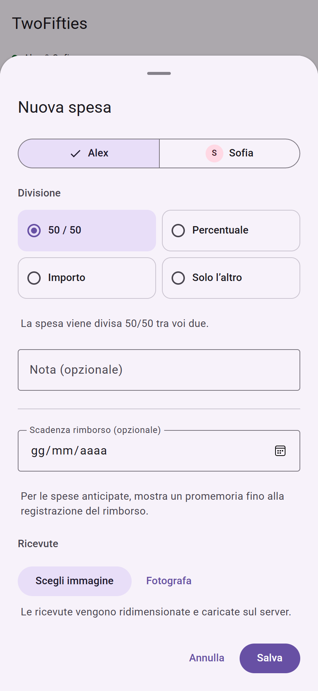</a></td>
</tr>
</table>

<table>
<tr>
<td width="50%" valign="top"><h3>07 · Saldo protetto da conferma</h3>
Settlement with confirmation
<a href="07-conferma-saldo.png">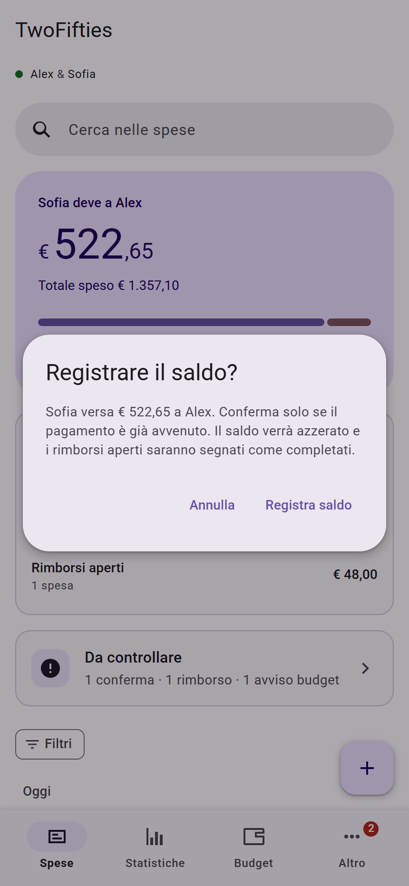</a></td>
<td width="50%" valign="top"><h3>08 · Ricerca nei movimenti</h3>
Search your transactions
<a href="08-ricerca.png">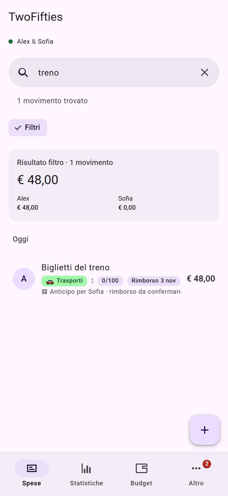</a></td>
</tr>
</table>

<table>
<tr>
<td width="50%" valign="top"><h3>09 · Statistiche mensili</h3>
Monthly statistics
<a href="09-statistiche.png">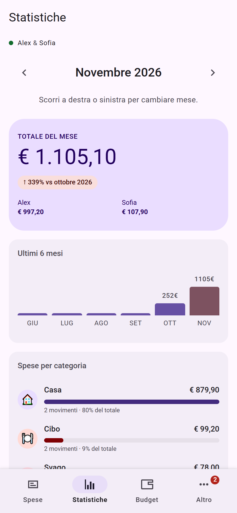</a></td>
<td width="50%" valign="top"><h3>10 · Budget per categoria</h3>
Budgets by category
<a href="10-budget.png">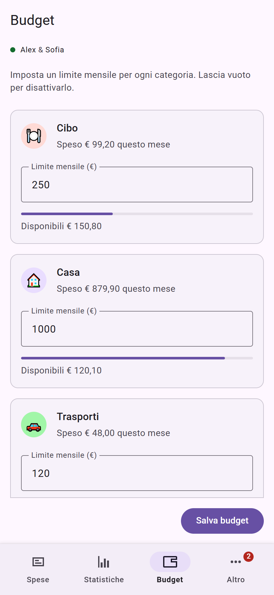</a></td>
</tr>
</table>

<table>
<tr>
<td width="50%" valign="top"><h3>11 · Strumenti organizzati in Altro</h3>
Organized tools in More
<a href="11-altro.png">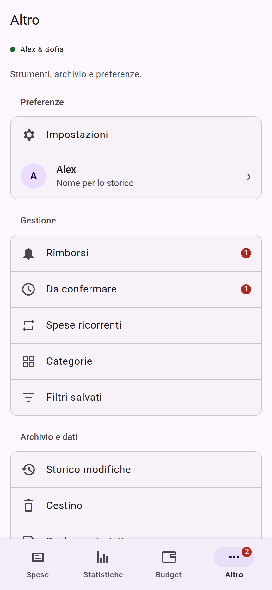</a></td>
<td width="50%" valign="top"><h3>12 · Anticipi e rimborsi</h3>
Advances and reimbursements
<a href="12-rimborsi.png">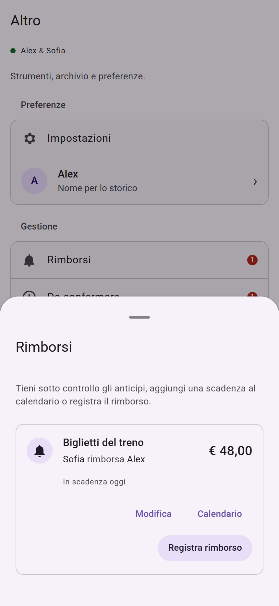</a></td>
</tr>
</table>

<table>
<tr>
<td width="50%" valign="top"><h3>13 · Spese ricorrenti</h3>
Recurring expenses
<a href="13-ricorrenze.png">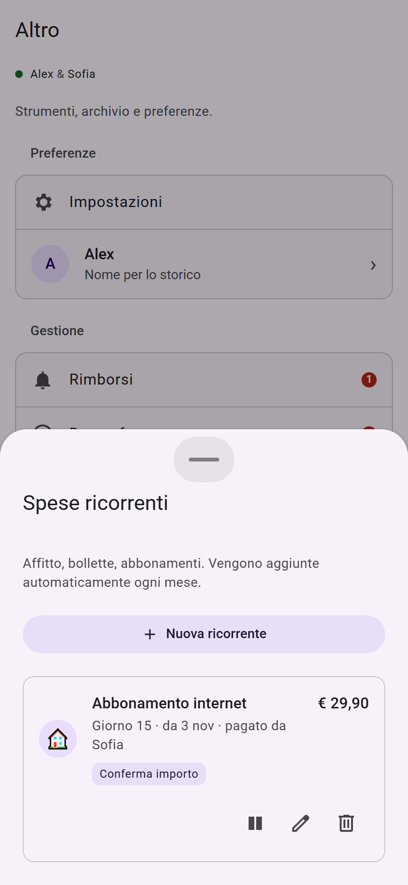</a></td>
<td width="50%" valign="top"><h3>14 · Ricorrenze da confermare</h3>
Recurring expenses awaiting approval
<a href="14-da-confermare.png">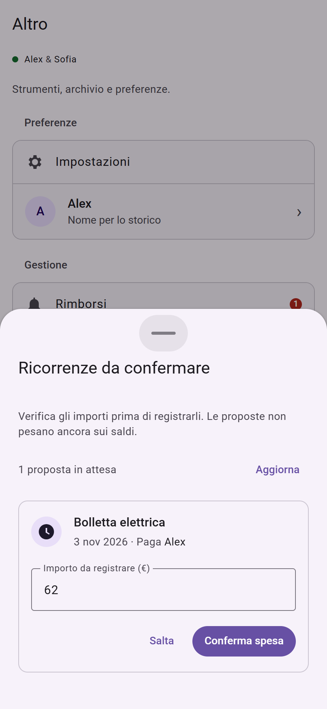</a></td>
</tr>
</table>

<table>
<tr>
<td width="50%" valign="top"><h3>15 · Categorie delle spese</h3>
Expense categories
<a href="15-categorie.png">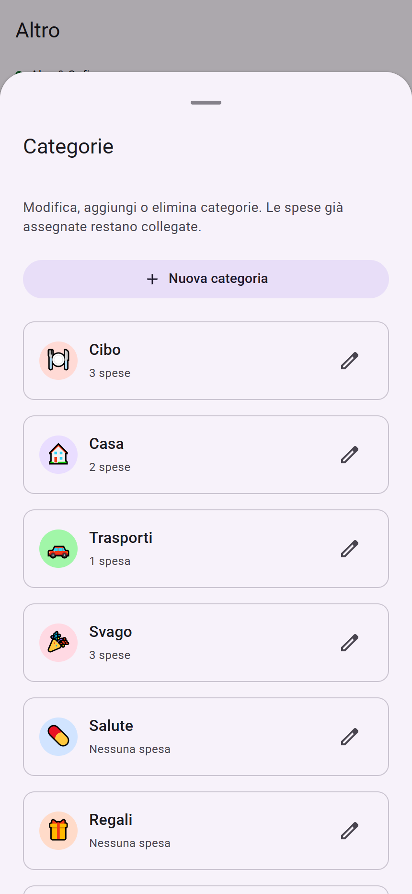</a></td>
<td width="50%" valign="top"><h3>16 · Viste e filtri salvati</h3>
Saved views and filters
<a href="16-filtri-salvati.png">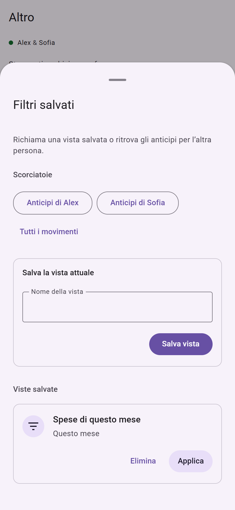</a></td>
</tr>
</table>

<table>
<tr>
<td width="50%" valign="top"><h3>17 · Storico delle modifiche</h3>
Change history
<a href="17-storico.png">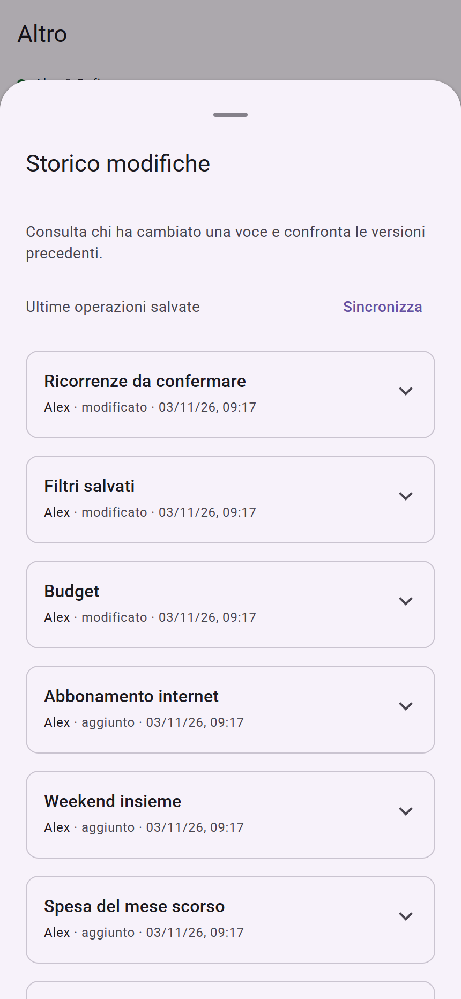</a></td>
<td width="50%" valign="top"><h3>18 · Recupero dal cestino</h3>
Restore from trash
<a href="18-cestino.png">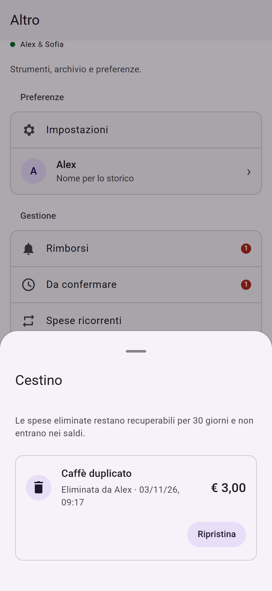</a></td>
</tr>
</table>

<table>
<tr>
<td width="50%" valign="top"><h3>19 · Backup e ripristino</h3>
Backup and restore
<a href="19-backup.png">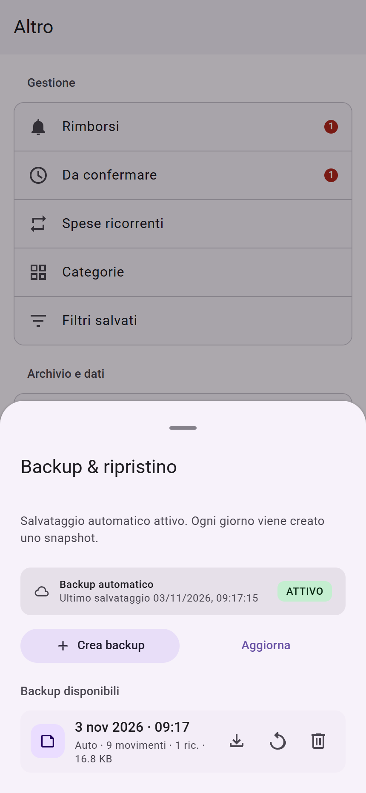</a></td>
<td width="50%" valign="top"><h3>20 · Importazione JSON e CSV</h3>
JSON and CSV import
<a href="20-importazione.png">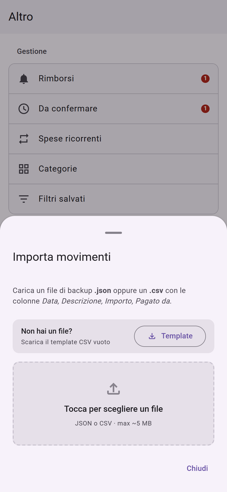</a></td>
</tr>
</table>

<table>
<tr>
<td width="50%" valign="top"><h3>21 · Esportazione Excel</h3>
Excel export
<a href="21-esportazione.png">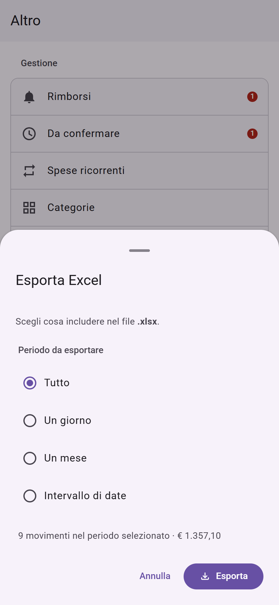</a></td>
<td width="50%" valign="top"><h3>22 · Impostazioni ordinate</h3>
Organized settings
<a href="22-impostazioni.png">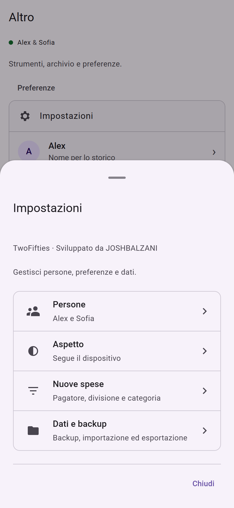</a></td>
</tr>
</table>

<table>
<tr>
<td width="50%" valign="top"><h3>23 · Nomi e autore delle modifiche</h3>
Names and change author
</td>
<td width="50%" valign="top"><h3>24 · Lingua e tema</h3>
Language and theme
<a href="24-lingua-tema.png">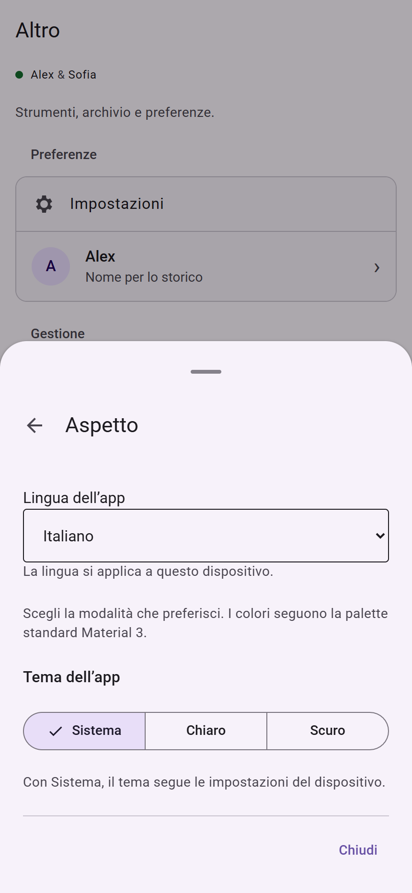</a></td>
</tr>
</table>

<table>
<tr>
<td width="50%" valign="top"><h3>25 · Tema scuro Material 3</h3>
Material 3 dark theme
<a href="25-tema-scuro.png">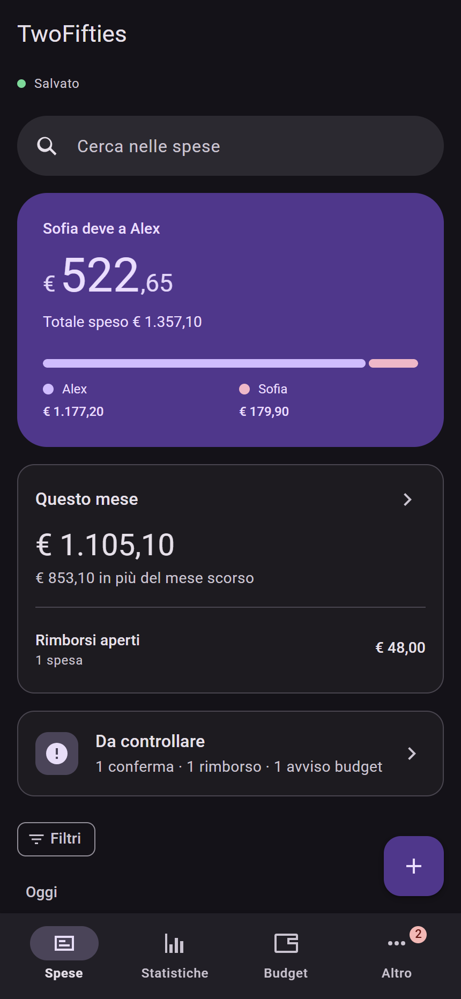</a></td>
<td width="50%" valign="top"><h3>26 · Interfaccia in inglese</h3>
English interface
<a href="26-english.png">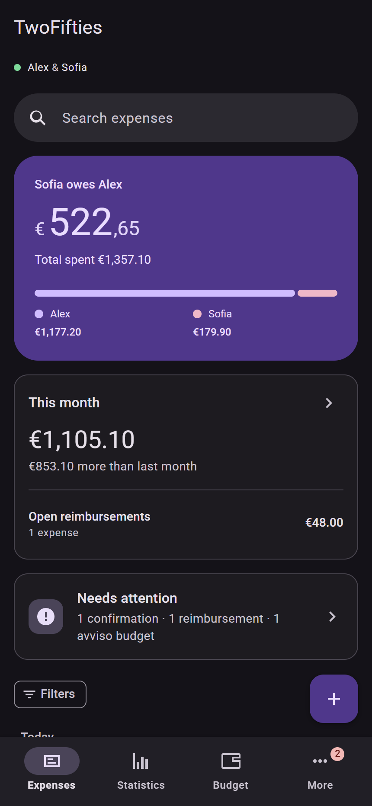</a></td>
</tr>
</table>

## Reproduce the gallery

Run `node scripts/screenshots.cjs` from the repository root after installing dependencies and the Playwright browser. It starts a temporary server, creates fictitious records, captures the screens and removes the temporary server data. It never connects to a running personal instance. On Windows it uses installed Microsoft Edge.
